  

### ✦ SOBRE.MÍ

Soy **Noelia Fernández Páez**, Analista de Datos en Santa Cruz, Bolivia, con 0+ años de experiencia. Data Analysis with Python is the best!

**Skills:** PostgreSQL · Python · Excel

  
  
  

### ✦ PROYECTOS.DESTACADOS

- **Simulations_Portfolio**
- **Portfolio_Data_Analysis**

  

✦ ✦ ✦  Diseñado con ♥ y un poco de vibecoding :3 ✨

