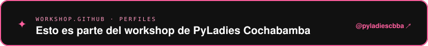

  

### ✦ SOBRE.MÍ

### Hello, I'm **Noelia Fernández Páez** 👋

I'm a **Chemical Engineer** currently studying to become a **Data Analyst** and **Python Developer**. 

I'm interested in building process simulations and solving engineering problems with Python, using libraries like **Pandas**, **NumPy**, and **Matplotlib**.

* 🌱 **Currently learning:** Data analysis and Python programming.
* 💻 **Tools I use:** Python, Jupyter Notebooks, Google Colab, and GitHub. 

**Skills:** PostgreSQL · Python · Excel

  
  
  

### ✦ PROYECTOS.DESTACADOS

- **Simulations_Portfolio**
- **Portfolio_Data_Analysis**

  

✦ ✦ ✦  Diseñado con ♥ y un poco de vibecoding :3 ✨

